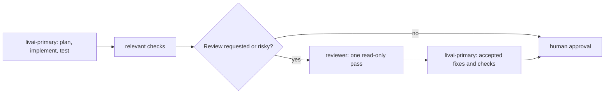

# Simple OpenCode Three-Agent Workflow

Install the OpenCode workflow with `make install` (alias: `make install-opencode`). It adds missing configuration, instructions, skills, and commands to `${OPENCODE_CONFIG_DIR:-$HOME/.config/opencode}` without replacing existing files or same-named skill directories. It does not install the CLI or authenticate accounts.

## Workflow



`livai-explorer` is optional. `livai-primary` invokes it only for a precise, read-only codebase investigation that will materially reduce uncertainty. It never edits files.

## OpenCode agents

| Agent            | Model                                  | Role                                                                                                       | Permissions                                                                              |
| ---------------- | -------------------------------------- | ---------------------------------------------------------------------------------------------------------- | ---------------------------------------------------------------------------------------- |
| `livai-primary`  | `livai/gpt-6.1-sol`, medium            | Default primary: plans, implements, tests, and fixes. Use high reasoning only for difficult or risky work. | Normal development access; may call only LivAI Explorer or Reviewer.                     |
| `livai-explorer` | `livai/gpt-6-luna`, low                | Targeted repository investigation for LivAI Primary.                                                       | Read/search only; no shell, edits, web access, or delegation.                            |
| `primary`        | `openai/gpt-6.2-sol`, medium           | OpenAI-backed primary: plans, implements, tests, and fixes.                                                | Normal development access; may call only Explorer or Reviewer.                           |
| `reviewer`       | `github-copilot/claude-opus-5.5`, high | One independent review when requested or for risky changes.                                                | Read-only; may inspect `git status`, `git diff`, and `git show`; no edits or delegation. |

Select `primary` for the OpenAI-backed workflow. It delegates exploration to `openai/gpt-6.2-sol-ultrafast` at low reasoning. The LivAI profiles keep their existing models because that catalog did not expose GPT‑6.2. GitHub Copilot remains the reviewer for both workflows. If it is unavailable, configure the `reviewer` model as `livai/gpt-6.1-sol` with high reasoning. The reviewer is skipped for trivial or mechanical edits.

Explorer and Reviewer each have one focused skill, installed globally by `make install`:

- `explore`: concise read-only codebase investigation.
- `review`: one read-only review pass.

OpenCode primary uses its always-on prompt and has no skill access. Each remaining skill is visible only to its matching agent.

### Primary responses

Both primary agents answer questions and review-only requests without editing. For "plan first", "no code", or unclear authorization to implement, they present the answer or plan and stop; a plan is not permission to implement. An explicit implementation request allows them to proceed through verification without another approval turn. User-specified response formats take precedence. Simple questions and trivial edits do not need a formal plan.

Use the repository's plan format when defined. Otherwise, default to a short checklist covering affected files, behavior changes, and validation. Add sections only for material risks, constraints, or unresolved decisions; use formal plans only when complexity warrants them. All written artifacts follow the [documentation style rules](AGENTS.md#documentation-style), regardless of chat mode.

After implementation, they end with a brief summary: what changed, checks run, and relevant checks skipped and why. They state plainly when work is incomplete and never imply checks ran when they did not.

## Worktree directories

Store Git worktrees at `~/worktrees/<repo>/<branch>` (for example, `~/worktrees/my-app/feature/add-login`). The template allows `external_directory` access and `edit` operations under `~/worktrees/**`, using OpenCode's path-keyed permission objects and home-directory expansion. Catch-all defaults come first and path-specific allowances last because the last matching rule wins; other external paths still require approval, and ordinary edit defaults are unchanged.

The explorer and reviewer agents also allow external-directory access under `~/worktrees/**`, while denying other external directories. Their read-only edit restrictions and existing Bash restrictions remain unchanged. Apply agent permission changes to an existing installation with `make update-agents`, then restart OpenCode.

Directory access does not bypass shell permissions or agent-specific restrictions. Explorers and the reviewer retain their explicit external-directory denials and read-only edit permissions; the reviewer's restricted shell rules are unchanged. See [OpenCode permissions](https://opencode.ai/docs/permissions/) for matching and agent override semantics.

## Workflow commands

`/plan` and `/implement` accept an ad-hoc task description or use the current task or issue from chat context; no GitHub issue or GitHub access is required for ad-hoc planning or implementation. If the task is missing or ambiguous, they ask for clarification and stop. They read a GitHub issue only when the task is tied to a clearly identified issue. `/review-again` and `/draft-pr` derive the current issue from chat context; if it is missing or ambiguous, they report that and stop without asking for a number. `/export-plan` just uses the latest generated plan.

| Command | Stage |
| --- | --- |
| `/plan [task description]` | Plan an ad-hoc task or the current issue, inspecting code and reading the issue only when applicable. No edits; stops for approval. |
| `/export-plan` | Save the latest conversation plan to `docs/github-issues/<branch-slug>/plan.md` at the current repository root. Exports only; does not approve implementation. |
| `/implement [task description]` | Implement the approved conversation plan for an ad-hoc task or the current issue in ordered phases, update tests/docs, check and commit each logical group, then run full validation once. Stops if no approved plan exists for the selected task. |
| `/review-again` | Review the actual changes against the current issue, fix confirmed problems, and rerun checks. |
| `/draft-pr` | Commit intended changes, push, and open a draft PR for the current issue using the repository template. |

For example, `/plan Add a dark mode toggle` plans directly from that description, while `/plan` uses the current task or issue already discussed in chat. After approving the plan, `/implement` uses that same chat context, or `/implement Add a dark mode toggle` selects the task explicitly. Neither command creates a GitHub issue. The issue requirements for `/review-again` and `/draft-pr` remain unchanged.

For `/implement`, additional instructions, including text below the command, constrain the task and its approved plan. A GitHub issue can still be identified explicitly, but is optional. For example:

```text
/implement Fix the cache invalidation bug. Keep the public API unchanged.
Focus on the cache invalidation fix and add a regression test.
```

Approve the plan before invoking `/implement`. This command authorizes commits for each verified logical group unless additional user instructions restrict committing; ordinary implementation approval alone does not authorize commits. `/implement` executes the approved plan in ordered phases, one logical group at a time. Run focused tests and changed-file formatting/lint checks before each commit, then the full suite and repository-wide checks once at the end. Invoke `/draft-pr` only after reviewing the completed work and validation; earlier stages never push or open a PR. The draft remains open for human review, with no automatic merge. These are prompt instructions, not a technical permission sandbox.

`/export-plan` saves the latest generated plan unchanged, creates missing directories, and replaces any previous export. It uses the current branch, removes its first slash-delimited prefix (such as `feature/` or `devops/`), and replaces any remaining slashes with hyphens. For example, `feature/add-login` exports to `docs/github-issues/add-login/plan.md`, and `devops/ci/cache` exports to `docs/github-issues/ci-cache/plan.md`. A branch without a slash is used unchanged. If there is no plan or the repository/branch cannot be determined, it stops without exporting. `/plan` remains read-only; invoke `/export-plan` separately to save its output.

In OpenCode, commands use the currently selected agent. Select `livai-primary` or `primary`; the read-only `reviewer` cannot implement fixes or publish a PR. `/review-again` is a user-requested direct review/fix pass, not another delegated reviewer invocation. GitHub operations require `gh` authentication and repository access.

For an existing installation, install the commands without changing the configuration:

```bash
make install-opencode-commands
```

This copies missing files from `global/opencode/commands/` into `${OPENCODE_CONFIG_DIR:-~/.config/opencode}/commands/`. Existing same-named commands (including symlinks) are preserved. Use `make update-opencode-commands` to replace only OpenCode's five workflow commands; this overwrites local edits. `/plan` overrides OpenCode's built-in command of the same name, if present.

### Pi workflow (optional)

Run `make install-pi`, then `/reload` in Pi. This installs or refreshes the global `AGENTS.md`, five prompt templates, and the workflow extension in `${PI_CODING_AGENT_DIR:-$HOME/.pi/agent}`. **Back up local edits to those files first.** Refresh refuses symlinked managed paths. Other config and the Pi CLI are unchanged; `make install` only covers OpenCode.

Use `make install-pi-instructions`, `make install-pi-commands`, or `make install-pi-workflow` to install just one component without replacing existing files. The extension takes precedence over the `/plan` prompt template.

- `/plan [task]` keeps the plan in your current conversation and limits the model to built-in read/search tools. Paste issue details if needed. Use `/plan-exit` to restore your previous tools; this does not approve the plan or start implementation.
- The current session is the primary. To make GPT‑6.2 Sol its default without limiting manual model selection, merge `"defaultProvider": "openai-codex"`, `"defaultModel": "gpt-6.2-sol"`, and `"defaultThinkingLevel": "medium"` into your Pi `settings.json`.
- The primary can delegate a focused codebase question to `explorer` (GPT‑6.2 Sol, low). It calls `reviewer` (Copilot Claude Opus 5.5, high) once after checks for risky changes or when requested. `/review-independent` is replaced by delegation; to request it directly, ask Pi for an independent review. `/review-again` still reviews and fixes in the primary session.
- Both subagents run in fresh Pi processes with read/search tools only. Keep `pi` on `PATH` and authenticate both providers. `/implement` captures the Git base before changes so review includes subsequent commits; outside that workflow, give an explicit Git base for committed changes. Untracked files are excluded.

These are model tool restrictions, not OS sandboxes. Review evidence and inspected files can be sent to your model provider.

#### Host approvals and isolation

Normal Pi sessions ask before recognized direct Bash calls that force-push, delete remote refs, discard local Git work, escalate privileges, or change system packages, services, firewall rules, or disks. Pi shows the full command and allows it once only if approved; declining, canceling, or having no confirmation UI blocks it. Plan mode still blocks shell tools outright. Routine edits, checks, local dependency installs, ordinary pushes, and PR creation do not prompt; existing authorization rules still apply.

These gates prevent some accidents, not access: complex shell syntax (including heredocs) can cause missed or extra prompts. The gates do not inspect scripts, aliases, or other tools, and do not intercept commands you type yourself.

| Work | Recommended setup |
| --- | --- |
| Supervised work in a trusted repo with established dependencies | Host Pi with the gates. Use the lockfile and project `uv` or Conda environment; neither limits OS permissions. |
| New or upgraded dependencies, unfamiliar install hooks or build scripts | Use a disposable container or, for stronger isolation, a VM. |
| Unattended multi-agent work | Run all of Pi, subagents, and checks inside a disposable container or VM. Expose only the intended checkout, not your home directory, SSH agent, or Docker socket. Provide only required model credentials, restrict network access where practical, and review and publish from the host. |

Pi's optional Gondolin example isolates built-in tools, not the whole workflow. It is not installed by this repo.

## Providers

The OpenCode template enables these providers:

- OpenAI, for the alternate `primary` and `explorer` workflow.
- GitHub Copilot, for the preferred Claude Opus 5.5 reviewer.
- LivAI, for the default `livai-primary` and `livai-explorer` workflow. Its custom endpoint includes `livai/gpt-6-luna`, `livai/gpt-6-sol`, `livai/gpt-6.1-sol`, and `livai/gpt-6-astra`. These models are available to API Developer keys; Service key availability will follow over the next couple of weeks. LivAI is deliberately a first-class workflow, not an automatic fallback.

Authenticate the providers you intend to use, then refresh the model list:

```bash
opencode auth login
make refresh-models
```

Confirm the exact IDs exposed to your account before changing model assignments. For LivAI, set the API key in your user-owned configuration; never commit it.

Run `make update-opencode` to upgrade OpenCode, refresh its model catalog, and sync the configured template sections, in that order. Installations without `provider.livai` skip the LivAI model section while still updating agents and permissions. OpenCode detects the installation method automatically. A failed step stops the remaining steps.

## OpenCode setup

1. Install OpenCode using its [official instructions](https://opencode.ai/).
2. Install the configuration, skills, and commands (safe to rerun):

   ```bash
   make install-opencode
   ```

    This copies missing configuration, `AGENTS.md`, skills, and prompt commands to `${OPENCODE_CONFIG_DIR:-~/.config/opencode}`. It never replaces an existing configuration, instructions, same-named skill, or command. An existing configuration does not prevent missing components from being installed.

3. Authenticate the providers above and start OpenCode.

Existing user-owned configuration remains yours. Merge the three-agent section deliberately rather than overwriting it, then install any missing skills without changing your config:

```bash
make install-opencode-skills
```

To explicitly refresh installed workflow templates:

```bash
make update-opencode-skills    # Refresh explore/review SKILL.md files
make update-opencode-commands  # Refresh the five workflow commands
```

These update targets also install missing templates. They **overwrite local edits** to the managed `SKILL.md` files and command templates; review or back up customizations first. They preserve unrelated skills, commands, extra files inside skill directories, and `opencode.jsonc`. Symlinked or incompatible managed destinations are rejected rather than followed or replaced. `update-skills` updates only the two managed `SKILL.md` files, not entire skill directories. `update-opencode` remains independent of these workflow-template updates.

To receive updates to the primary response rules in an existing installation, review and merge the two primary prompts into your user-owned configuration. Alternatively, `make update-agents` refreshes the whole `agent` section from the template (after refreshing models); it **replaces all customizations in the user-owned agent section**, not just these prompts. Review your changes before running it. `make install` copies the updated prompts only when no configuration exists yet.

### Refreshing template sections

Run every OpenCode update with one command:

```bash
make update-opencode-all
```

This target and its alias `update-all` run `update-opencode`, `update-opencode-instructions`, `update-opencode-skills`, and `update-opencode-commands` sequentially and stop on the first failure. Back up customizations first: this replaces managed configuration sections, `AGENTS.md`, skills, and commands.

`make update-agents` runs `make refresh-models` before updating configuration. If the model refresh fails, the configuration update stops.

When model releases require configuration updates, refresh only the relevant user-owned sections from the repository template:

```bash
make update-livai-models
make update-agents
make update-permissions
make update-opencode-instructions
```

`make update-opencode` upgrades OpenCode, refreshes models, and syncs all three configuration sections. `make update-opencode-instructions` creates or updates `${OPENCODE_CONFIG_DIR:-~/.config/opencode}/AGENTS.md` from this repository's template. The configuration commands replace only `provider.livai.models`, `agent`, or `permission`; when `provider.livai` is absent, its model section is skipped. All other settings in your `opencode.jsonc` remain unchanged.

## Clean up retired integrations

```bash
make uninstall          # Preview
make uninstall APPLY=1  # Apply after reviewing the preview
```

Requires Ruby 2.6+. Close Claude Code and OpenCode before applying. Use `CLAUDE_CONFIG_DIR` or `OPENCODE_CONFIG_DIR` to select a custom location. Defaults are `$HOME/.claude` and `${XDG_CONFIG_HOME:-$HOME/.config}/opencode`.

- **Claude Code:** Removes files that exactly match retired templates. The old installer did not track ownership, so review each match before applying. Review modified files and settings manually; for example, `includeGitInstructions: false` may remain in a shared `settings.json`.
- **Caveman:** Removes the files, registration, and instruction block verified against `.caveman-install.json`. It leaves untracked installs alone and stops on modified or unsafe managed paths. Resolve those conflicts before retrying cleanup or refreshing OpenCode instructions.

Cleanup preserves CLI binaries, credentials, history, backups, symlinks, and unrelated configuration.

## Optional Lazygit setup

Install Lazygit, then configure it:

```bash
make install-lazygit
make setup-lazygit
```

On macOS, installation uses Homebrew and prints a link to its installation instructions if it is missing. On Linux, it installs the official release executable into `~/.local/bin` without sudo, checks the archive against the release's published SHA-256 checksums, and removes temporary files. Supported architectures are x86-64, ARM64, ARMv6/ARMv7 (the ARMv6 build), and 32-bit x86. Pin a Linux release for reproducibility:

```bash
make install-lazygit LAZYGIT_VERSION=0.66.0
```

Unpinned installs preserve an existing Lazygit; otherwise they fetch the latest release. A pinned Linux install preserves a matching version or replaces only a regular executable at `~/.local/bin/lazygit` after verification. It refuses to replace symlinks, incompatible files, or mismatched installations elsewhere in `PATH`. macOS version pinning is not supported. Installation reports the executable path and version. If `~/.local/bin` is not on `PATH`, follow the printed `export PATH` instructions; these scripts never edit shell configuration.

Configuration requires Ruby with its standard-library `psych` YAML parser (no extra Ruby gems or Python packages). Setup queries `lazygit --print-config-dir` when advertised by the CLI; older versions fall back to `CONFIG_DIR`, then `XDG_CONFIG_HOME/lazygit`, then `~/Library/Application Support/lazygit` on macOS or `~/.config/lazygit` on Linux. It can use the newly installed `~/.local/bin/lazygit` even before `PATH` is updated. `LG_CONFIG_FILE` overrides are rejected to avoid editing an inactive file.

Setup creates `$HOME/worktrees` if missing, creates `config.yml` if missing, and sets `worktree.defaultPath` to `~/worktrees`, preserving unrelated YAML content and comments. Repeated runs make no further changes. If the worktree directory cannot be created, setup fails before changing the config. Invalid YAML, duplicate keys, incompatible structures, anchored worktree settings, multiline path values, and symlinked configs fail without changing the file. The updated config path is printed. **Restart Lazygit** after configuration.

This setting supplies a **suggested parent directory** in Lazygit's worktree-creation prompt; it does **not** automatically append the repository name or create worktrees. To follow this repository's convention, choose a path such as `~/worktrees/my-app/feature/add-login` in that prompt.

## Optional NERSC filesystem rules

```bash
make install-nersc-rules
make uninstall-nersc-rules
```

This profile is independent of the agent configuration.

## Verification

```bash
make test      # Fast: templates and Makefile
make test-all  # After changing global/*.sh, *.rb, or *.py
# Focused installer/configuration checks (mocked downloads; no host install):
make lazygit-test
make uninstall-test
```

## Repository layout

- `global/opencode/opencode.jsonc`: user-owned native OpenCode template.
- `global/opencode/skills/`: the two focused OpenCode skills.
- `global/opencode/commands/`: issue planning, plan export, implementation, optional review/fix, and human-gated draft PR prompts.
- `global/install-opencode-config.sh`: repeatable missing-component installer and explicit skill/command updater.
- `global/install-lazygit.sh`, `global/setup-lazygit.sh`, `global/setup-lazygit-config.rb`: optional Lazygit installation and comment-preserving worktree configuration.
- `global/uninstall-legacy.rb`, `global/manage-caveman.rb`: cleanup for retired integrations.
- `profiles/nersc/`: optional filesystem instruction profile.
- `test/`: configuration and lifecycle checks.
