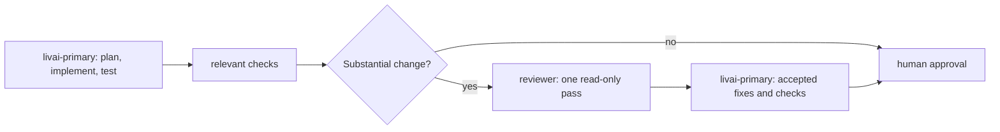

# Simple OpenCode and Claude Code Three-Agent Workflow

This repository provides parallel native OpenCode and Claude Code configurations for software development. Both use shared [AGENTS.md](AGENTS.md) engineering rules, five workflow commands, and focused explorer/reviewer skills. Their configuration files and installations remain separate.

## Parallel installation and updates

Install both tools' workflow files, or select one:

```bash
make install
make install-opencode
make install-claude
```

`make install` now installs missing configuration, instructions, skills, commands, and agent definitions for **both tools**. Existing files and same-named skill directories are preserved. OpenCode installs to `${OPENCODE_CONFIG_DIR:-$HOME/.config/opencode}`; Claude installs to `${CLAUDE_CONFIG_DIR:-$HOME/.claude}`. Template installation does not install either CLI or authenticate accounts.

| Both tools | OpenCode only | Claude only |
| --- | --- | --- |
| `install-skills` | `install-opencode-skills` | `install-claude-skills` |
| `install-commands` | `install-opencode-commands` | `install-claude-commands` |
| `update-skills` | `update-opencode-skills` | `update-claude-skills` |
| `update-commands` | `update-opencode-commands` | `update-claude-commands` |
| `update-agents-md` | `update-opencode-instructions` | `update-claude-instructions` |
| `update-all` | `update-opencode-all` | `update-claude-all` |

Prefix each target with `make`. `update-skills-commands` updates skills and commands for both tools. Combined targets run sequentially and stop on failure, including under parallel Make; they do not roll back earlier successful updates.

Explicit updates **overwrite local edits** to managed templates. Back up customizations first. Tool-specific targets never change the other tool's installation. `update-agents`, `update-permissions`, `update-livai-models`, and `update-opencode` retain their existing OpenCode-only behavior. Optional integrations remain separate and opt-in.

The OpenCode permission template now asks approval for combined lifecycle targets and pre-approves only scoped OpenCode template maintenance. Review and merge these permission changes, or run `make update-permissions` to replace your permission section, then restart OpenCode.

### Claude Code setup

1. Install Claude Code using its [official instructions](https://code.claude.com/docs/en/setup).
2. Run `make install-claude`, or `make install` for both tools.
3. Start `claude` and use browser sign-in with your Claude Pro account. API-key authentication uses separate API billing, not your subscription.
4. Restart Claude Code after installation. Check `/context all` for loaded instructions and the `/` menu for workflow commands.

Claude receives `CLAUDE.md`, adjacent `AGENTS.md`, `settings.json`, `agents/{explorer,reviewer}.md`, five `commands/*.md` files, and `skills/{explore,review}/SKILL.md`. `CLAUDE.md` imports the shared rules and supplies the primary workflow. Main conversation acts as primary; both subagents inherit its model and allow only Read, Glob, and Grep. Supply actual diffs and check results when requesting review: reviewer has no shell access. These restrictions intentionally differ from OpenCode's restricted reviewer shell access.

Claude commands retain the [workflow behavior below](#workflow-commands), including commit authorization in `/implement` and publishing authorization in `/draft-pr`. Commands require explicit user invocation and run in the main conversation. Support skills preload into their matching agents and stay hidden from slash menus. Instruction-level delegation rules are not a technical sandbox or exact OpenCode permission equivalent.

`/plan` intentionally replaces Claude's built-in command of the same name. An existing same-named skill takes precedence over a command file; installation preserves such customizations. Check command discovery before relying on the workflow. See [Claude skill precedence](https://code.claude.com/docs/en/skills#resolve-skills-that-share-a-name).

Additional Claude-only targets:

```bash
make install-claude-agents
make update-claude-agents
make update-claude-settings
```

`update-claude-instructions` refreshes both installed instruction files. `update-claude-all` refreshes all managed Claude files without upgrading the CLI. Settings updates manage only `includeGitInstructions: false`, so repository workflow rules replace Claude's built-in Git guidance. They preserve unrelated JSON keys, including permissions, hooks, and authentication settings; JSON formatting may change. Installation preserves existing settings unchanged. Invalid JSON or non-object settings stop full installation/update before writes.

Claude updates validate all selected managed paths before writes, reject symlinks and incompatible destinations, preserve file modes, and replace files atomically. Writes are not a multi-file transaction: an I/O failure can leave earlier files updated. Installation preserves existing linked files and skill directories but refuses linked managed directories when writing missing files. No lifecycle command changes credentials, session history, or unrelated files. Do not run concurrent lifecycle commands.

For a custom directory, set `CLAUDE_CONFIG_DIR` for installation, updates, **and Claude Code**. Current Claude versions can read repository `AGENTS.md` directly when no project `CLAUDE.md` takes precedence. Older versions, or projects with their own `CLAUDE.md`, can import shared rules with `@AGENTS.md` in that project file. Global `CLAUDE.md` imports only its adjacent global rules. See [Claude instruction loading](https://code.claude.com/docs/en/memory#agents-md).

Claude Caveman integration, NERSC profile integration, and cloud/Cowork distribution are outside this setup.

## Workflow



`livai-explorer` is optional. `livai-primary` invokes it only for a precise, read-only codebase investigation that will materially reduce uncertainty. It never edits files.

## OpenCode agents

| Agent            | Model                                  | Role                                                                                                       | Permissions                                                                              |
| ---------------- | -------------------------------------- | ---------------------------------------------------------------------------------------------------------- | ---------------------------------------------------------------------------------------- |
| `livai-primary`  | `livai/gpt-6.1-sol`, medium            | Default primary: plans, implements, tests, and fixes. Use high reasoning only for difficult or risky work. | Normal development access; may call only LivAI Explorer or Reviewer.                     |
| `livai-explorer` | `livai/gpt-6-luna`, low                | Targeted repository investigation for LivAI Primary.                                                       | Read/search only; no shell, edits, web access, or delegation.                            |
| `primary`        | `openai/gpt-6.1-sol`, medium           | OpenAI-backed primary: plans, implements, tests, and fixes.                                                | Normal development access; may call only Explorer or Reviewer.                           |
| `reviewer`       | `github-copilot/claude-opus-5.5`, high | One independent review after substantial changes.                                                          | Read-only; may inspect `git status`, `git diff`, and `git show`; no edits or delegation. |

The existing `primary` and `explorer` agents remain available as the OpenAI-backed workflow. Select `primary` explicitly when you want that path. GitHub Copilot remains the reviewer for both workflows. If it is unavailable, configure the `reviewer` model as `livai/gpt-6.1-sol` with high reasoning. The reviewer is skipped for trivial or mechanical edits.

Explorer and Reviewer each have one focused skill, installed globally by `make install`:

- `explore`: concise read-only codebase investigation.
- `review`: one read-only review pass.

OpenCode primary uses its always-on prompt and has no skill access. Each remaining skill is visible only to its matching agent.

### Primary responses

Both primary agents answer questions and review-only requests without editing. For "plan first", "no code", or unclear authorization to implement, they present the answer or plan and stop; a plan is not permission to implement. An explicit implementation request allows them to proceed through verification without another approval turn. User-specified response formats take precedence. Simple questions and trivial edits do not need a formal plan.

Use the repository's plan format when defined. Otherwise, default to a short checklist covering affected files, behavior changes, and validation. Add sections only for material risks, constraints, or unresolved decisions; use formal plans only when complexity warrants them. All written artifacts follow the [documentation style rules](AGENTS.md#documentation-style), regardless of chat mode.

After implementation, report **Result** (what changed and the outcome), **Validation** (checks run and their results, plus relevant checks not run and why), and **Remaining issues** (omit if none). State clearly when implementation is incomplete. A plan-only response must not use this results format or imply that checks ran.

## Worktree directories

Store Git worktrees at `~/worktrees/<repo>/<branch>` (for example, `~/worktrees/my-app/feature/add-login`). The template allows `external_directory` access and `edit` operations under `~/worktrees/**`, using OpenCode's path-keyed permission objects and home-directory expansion. Catch-all defaults come first and path-specific allowances last because the last matching rule wins; other external paths still require approval, and ordinary edit defaults are unchanged.

The explorer and reviewer agents also allow external-directory access under `~/worktrees/**`, while denying other external directories. Their read-only edit restrictions and existing Bash restrictions remain unchanged. Apply agent permission changes to an existing installation with `make update-agents`, then restart OpenCode.

Directory access does not bypass shell permissions or agent-specific restrictions. Explorers and the reviewer retain their explicit external-directory denials and read-only edit permissions; the reviewer's restricted shell rules are unchanged. See [OpenCode permissions](https://opencode.ai/docs/permissions/) for matching and agent override semantics.

## Workflow commands

`/plan` and `/implement` accept an ad-hoc task description or use the current task or issue from chat context; no GitHub issue or GitHub access is required for ad-hoc planning or implementation. If the task is missing or ambiguous, they ask for clarification and stop. They read a GitHub issue only when the task is tied to a clearly identified issue. `/review-again` and `/draft-pr` derive the current issue from chat context; if it is missing or ambiguous, they report that and stop without asking for a number. `/export-plan` just uses the latest generated plan.

| Command | Stage |
| --- | --- |
| `/plan [task description]` | Plan an ad-hoc task or the current issue, inspecting code and reading the issue only when applicable. No edits; stops for approval. |
| `/export-plan` | Save the latest conversation plan to `docs/github-issues/<branch-slug>/plan.md` at the current repository root. Exports only; does not approve implementation. |
| `/implement [task description]` | Implement the approved conversation plan for an ad-hoc task or the current issue in ordered phases, update tests/docs, check and commit each logical group, then run full validation once. Stops if no approved plan exists for the selected task. |
| `/review-again` | Review the actual changes against the current issue, fix confirmed problems, and rerun checks. |
| `/draft-pr` | Commit intended changes, push, and open a draft PR for the current issue using the repository template. |

For example, `/plan Add a dark mode toggle` plans directly from that description, while `/plan` uses the current task or issue already discussed in chat. After approving the plan, `/implement` uses that same chat context, or `/implement Add a dark mode toggle` selects the task explicitly. Neither command creates a GitHub issue. The issue requirements for `/review-again` and `/draft-pr` remain unchanged.

For `/implement`, additional instructions, including text below the command, constrain the task and its approved plan. A GitHub issue can still be identified explicitly, but is optional. For example:

```text
/implement Fix the cache invalidation bug. Keep the public API unchanged.
Focus on the cache invalidation fix and add a regression test.
```

Approve the plan before invoking `/implement`. This command authorizes commits for each verified logical group unless additional user instructions restrict committing; ordinary implementation approval alone does not authorize commits. `/implement` executes the approved plan in ordered phases, one logical group at a time. Run focused tests and changed-file formatting/lint checks before each commit, then the full suite and repository-wide checks once at the end. Invoke `/draft-pr` only after reviewing the completed work and validation; earlier stages never push or open a PR. The draft remains open for human review, with no automatic merge. These are prompt instructions, not a technical permission sandbox.

`/export-plan` saves the latest generated plan unchanged, creates missing directories, and replaces any previous export. It uses the current branch, removes its first slash-delimited prefix (such as `feature/` or `devops/`), and replaces any remaining slashes with hyphens. For example, `feature/add-login` exports to `docs/github-issues/add-login/plan.md`, and `devops/ci/cache` exports to `docs/github-issues/ci-cache/plan.md`. A branch without a slash is used unchanged. If there is no plan or the repository/branch cannot be determined, it stops without exporting. `/plan` remains read-only; invoke `/export-plan` separately to save its output.

In OpenCode, commands use the currently selected agent. Select `livai-primary` or `primary`; the read-only `reviewer` cannot implement fixes or publish a PR. In Claude, use the normal main session. `/review-again` is a user-requested direct review/fix pass, not another delegated reviewer invocation. GitHub operations require `gh` authentication and repository access.

For an existing installation, install the commands without changing the configuration:

```bash
make install-opencode-commands
```

This copies missing files from `global/opencode/commands/` into `${OPENCODE_CONFIG_DIR:-~/.config/opencode}/commands/`. Existing same-named commands (including symlinks) are preserved. Use `make update-opencode-commands` to replace only OpenCode's five workflow commands; this overwrites local edits. `/plan` overrides OpenCode's built-in command of the same name, if present.

## Providers

The OpenCode template enables these providers:

- OpenAI, for the alternate `primary` and `explorer` workflow.
- GitHub Copilot, for the preferred Claude Opus 5.5 reviewer.
- LivAI, for the default `livai-primary` and `livai-explorer` workflow. Its custom endpoint includes `livai/gpt-6-luna`, `livai/gpt-6-sol`, `livai/gpt-6.1-sol`, and `livai/gpt-6-astra`. These models are available to API Developer keys; Service key availability will follow over the next couple of weeks. LivAI is deliberately a first-class workflow, not an automatic fallback.

Authenticate the providers you intend to use, then refresh the model list:

```bash
opencode auth login
make refresh-models
```

Confirm the exact IDs exposed to your account before changing model assignments. For LivAI, set the API key in your user-owned configuration; never commit it.

Run `make update-opencode` to upgrade OpenCode, refresh its model catalog, and sync the configured template sections, in that order. Installations without `provider.livai` skip the LivAI model section while still updating agents and permissions. OpenCode detects the installation method automatically. A failed step stops the remaining steps.

## OpenCode setup

1. Install OpenCode using its [official instructions](https://opencode.ai/).
2. Install the configuration, skills, and commands (safe to rerun):

   ```bash
   make install-opencode
   ```

    This copies missing configuration, `AGENTS.md`, skills, and prompt commands to `${OPENCODE_CONFIG_DIR:-~/.config/opencode}`. It never replaces an existing configuration, instructions, same-named skill, or command. An existing configuration does not prevent missing components from being installed.

3. Authenticate the providers above and start OpenCode.

Existing user-owned configuration remains yours. Merge the three-agent section deliberately rather than overwriting it, then install any missing skills without changing your config:

```bash
make install-opencode-skills
```

To explicitly refresh installed workflow templates:

```bash
make update-opencode-skills    # Refresh explore/review SKILL.md files
make update-opencode-commands  # Refresh the five workflow commands
```

These update targets also install missing templates. They **overwrite local edits** to the managed `SKILL.md` files and command templates; review or back up customizations first. They preserve unrelated skills, commands, extra files inside skill directories, and `opencode.jsonc`. Symlinked or incompatible managed destinations are rejected rather than followed or replaced. `update-skills` updates only the two managed `SKILL.md` files, not entire skill directories. `update-opencode` remains independent of these workflow-template updates.

To receive updates to the primary response rules in an existing installation, review and merge the two primary prompts into your user-owned configuration. Alternatively, `make update-agents` refreshes the whole `agent` section from the template (after refreshing models); it **replaces all customizations in the user-owned agent section**, not just these prompts. Review your changes before running it. `make install` copies the updated prompts only when no configuration exists yet.

### Refreshing template sections

Run every OpenCode update with one command:

```bash
make update-opencode-all
```

This runs `update-opencode`, `update-opencode-instructions`, `update-opencode-skills`, and `update-opencode-commands` sequentially, then refreshes Caveman only if installed by this repository. It stops on the first failure even with parallel Make enabled. `update-opencode` already covers the model refresh and LivAI models, agents, and permissions, so these updates are not repeated. Review or back up customizations first: this replaces the managed configuration sections, `AGENTS.md` (preserving its Caveman activation block), skills, and commands. It does not enable optional integrations or configure Lazygit. Generic `update-all` then runs `update-claude-all`.

`make update-agents` runs `make refresh-models` before updating configuration. If the model refresh fails, the configuration update stops.

When model releases require configuration updates, refresh only the relevant user-owned sections from the repository template:

```bash
make update-livai-models
make update-agents
make update-permissions
make update-opencode-instructions
```

`make update-opencode` upgrades OpenCode, refreshes models, and syncs all three configuration sections. `make update-opencode-instructions` creates or updates `${OPENCODE_CONFIG_DIR:-~/.config/opencode}/AGENTS.md` from this repository's template. The configuration commands replace only `provider.livai.models`, `agent`, or `permission`; when `provider.livai` is absent, its model section is skipped. All other settings in your `opencode.jsonc` remain unchanged.

## Optional Caveman output styling

Use the repository's minimal installer, **not** Caveman's unified installer:

```bash
make install-opencode        # If no OpenCode configuration exists yet
make install-caveman
# Restart OpenCode and start a new session.
make update-caveman          # Refresh only this integration
make uninstall-caveman       # Remove only this integration
```

Setup needs Ruby 2.6+ (standard library only), curl, and an existing OpenCode configuration. It downloads Caveman **v3.2.0**, pinned to commit `e20f07e8152a0c0360f58c09e79d30ac94329991`, over HTTPS. Downloaded installer scripts are never executed. The plugin itself runs inside OpenCode; installing it means trusting upstream code. Review the pinned [plugin](https://github.com/JuliusBrussee/caveman/blob/e20f07e8152a0c0360f58c09e79d30ac94329991/src/plugins/opencode/plugin.js) before enabling it. Bumping the pin is a repository change, not an automatic upgrade to `latest`.

Only the four native plugin files, `skills/caveman/SKILL.md`, one plugin registration, and a marker-fenced instruction block are installed. No Cavecrew agents, slash-command files, extra modes, CLI, proxy, MCP, telemetry setup, provider routing, or credentials are added. The plugin reads the ruleset directly; existing skill permissions stay unchanged. It adds response-style system instructions but does not compress or rewrite prompts, tool results, or history. This works independently of provider choice, including LivAI and Copilot.

Standard Caveman prose is the default unless existing upstream Caveman mode settings override it. This minimal installation supplies only the standard ruleset, not alternate modes. Primary and subagent output should stay concise while retaining required headings, requested detail, technical meaning, and exact code/commands. Output styling is a model instruction, not a guarantee. Upstream uses shared machine-wide mode state in OpenCode, and static global instructions remain active for subagents; use `make uninstall-caveman` for reliable global deactivation rather than relying on a per-session toggle.

`OPENCODE_CONFIG_DIR` must match the plugin's runtime path: `${XDG_CONFIG_HOME:-$HOME/.config}/opencode`. Symlinked ancestors such as `/home` are supported; the OpenCode configuration directory itself and managed paths inside it must not be symlinks. For a custom location, use the same environment for setup, updates, **and OpenCode**:

```bash
export XDG_CONFIG_HOME="$HOME/custom-config"
export OPENCODE_CONFIG_DIR="$XDG_CONFIG_HOME/opencode"
make install
make install-caveman
opencode
```

Setup requires exactly one `opencode.jsonc` or `opencode.json`, preserves comments and unrelated settings, and saves a private first-install `.caveman-config-backup`. `.caveman-install.json` records ownership and digests. Repeat installation is a no-op. Updates and uninstall refuse missing/modified managed files, changed activation blocks, symlinks, or unowned conflicts; restore the recorded version before retrying. Existing upstream installs are not silently adopted. Unrelated and extra files are preserved. Uninstall keeps the configuration backup and runtime history, removes known mode flags, and never touches other agents. File writes are atomic with rollback on ordinary write failures, not a crash-proof transaction; do not run OpenCode during lifecycle changes.

`make update-agents-md` preserves exactly one valid Caveman instruction block; Ruby is required only when that block exists. `make update-all` refreshes Caveman only when its repository ownership record exists, with no new prerequisites or path restrictions for users who never installed it. `make install` remains opt-in with respect to Caveman. A killed lifecycle process may leave `.caveman-install.lock/`; remove that directory only after confirming no lifecycle command is running.

After restarting, test a concise explanation, a code/command response, and a request for detailed prose with both primary and subagent workflows.

## Optional Lazygit setup

Install Lazygit, then configure it:

```bash
make install-lazygit
make setup-lazygit
```

On macOS, installation uses Homebrew and prints a link to its installation instructions if it is missing. On Linux, it installs the official release executable into `~/.local/bin` without sudo, checks the archive against the release's published SHA-256 checksums, and removes temporary files. Supported architectures are x86-64, ARM64, ARMv6/ARMv7 (the ARMv6 build), and 32-bit x86. Pin a Linux release for reproducibility:

```bash
make install-lazygit LAZYGIT_VERSION=0.66.0
```

Unpinned installs preserve an existing Lazygit; otherwise they fetch the latest release. A pinned Linux install preserves a matching version or replaces only a regular executable at `~/.local/bin/lazygit` after verification. It refuses to replace symlinks, incompatible files, or mismatched installations elsewhere in `PATH`. macOS version pinning is not supported. Installation reports the executable path and version. If `~/.local/bin` is not on `PATH`, follow the printed `export PATH` instructions; these scripts never edit shell configuration.

Configuration requires Ruby with its standard-library `psych` YAML parser (no extra Ruby gems or Python packages). Setup queries `lazygit --print-config-dir` when advertised by the CLI; older versions fall back to `CONFIG_DIR`, then `XDG_CONFIG_HOME/lazygit`, then `~/Library/Application Support/lazygit` on macOS or `~/.config/lazygit` on Linux. It can use the newly installed `~/.local/bin/lazygit` even before `PATH` is updated. `LG_CONFIG_FILE` overrides are rejected to avoid editing an inactive file.

Setup creates `$HOME/worktrees` if missing, creates `config.yml` if missing, and sets `worktree.defaultPath` to `~/worktrees`, preserving unrelated YAML content and comments. Repeated runs make no further changes. If the worktree directory cannot be created, setup fails before changing the config. Invalid YAML, duplicate keys, incompatible structures, anchored worktree settings, multiline path values, and symlinked configs fail without changing the file. The updated config path is printed. **Restart Lazygit** after configuration.

This setting supplies a **suggested parent directory** in Lazygit's worktree-creation prompt; it does **not** automatically append the repository name or create worktrees. To follow this repository's convention, choose a path such as `~/worktrees/my-app/feature/add-login` in that prompt.

## Optional NERSC filesystem rules

```bash
make install-nersc-rules
make uninstall-nersc-rules
```

This profile is independent of the agent configuration.

## Verification

```bash
make test      # Fast: templates and Makefile
make test-all  # After changing global/*.sh, *.rb, or *.py
# Focused installer/configuration checks (mocked downloads; no host install):
make lazygit-test
make caveman-test
make claude-test
# Optional: actual pinned downloads + isolated plugin hooks (requires Node.js):
CAVEMAN_UPSTREAM_TEST=1 make caveman-test
```

## Repository layout

- `global/opencode/opencode.jsonc`: user-owned native OpenCode template.
- `global/claude/`: native Claude instructions, settings, agents, commands, and skills.
- `global/install-claude-config.sh`, `global/manage-claude-config.rb`: scoped Claude installation and updates (Ruby standard library only).
- `global/opencode/skills/`: the two focused OpenCode skills.
- `global/opencode/commands/`: issue planning, plan export, implementation, optional review/fix, and human-gated draft PR prompts.
- `global/install-opencode-config.sh`: repeatable missing-component installer and explicit skill/command updater.
- `global/install-lazygit.sh`, `global/setup-lazygit.sh`, `global/setup-lazygit-config.rb`: optional Lazygit installation and comment-preserving worktree configuration.
- `global/install-caveman.sh`, `global/manage-caveman.rb`: optional, scoped Caveman output-plugin lifecycle and instruction preservation.
- `profiles/nersc/`: optional filesystem instruction profile.
- `test/`: configuration and lifecycle checks.
